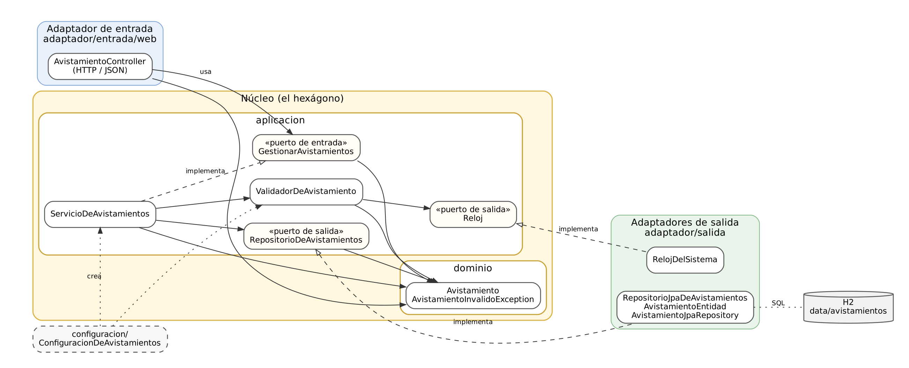

# Taller 5. Clean Architecture y arquitectura hexagonal

Karen Dayana Morera Fonseca

Repositorio: https://github.com/Ksrtn/avistamientos

## Parte 1. Investigación

### 1. El problema que ve Cockburn, puertos, adaptadores y la simetría

El autor nos muestra dos problemas que veía en las aplicaciones antes. El primero es que la lógica de negocio se mete dentro del código de la interfaz de usuario, y entonces no hay forma de probar la aplicación con pruebas automáticas ni de usarla desde otro programa. El segundo es que la aplicación queda amarrada a la base de datos real, esto significa que si la base se cae, los programadores no pueden trabajar. El autor dice que como tal es un solo problema, la lógica de negocio está revuelta con el código que habla con el usuario y con la base de datos (Cockburn, 2005).

Cockburn propone partir la aplicación en dos partes, lo de adentro y lo de afuera, y que lo de adentro no se revuelva con lo de afuera. Para conectar los dos lados usa puertos y adaptadores. Un puerto es lo que la aplicación necesita hacer con algo externo como guardar avistamientos, pero sin decir con qué tecnología se va a hacer. El adaptador es el que se encarga de esa parte técnica y traduce lo que pide el puerto a algo que el programa o el dispositivo de afuera entienda. Lo bueno es que a un mismo puerto se le pueden conectar adaptadores distintos. Puede ser una interfaz gráfica, unas pruebas automáticas o una base de datos de mentiras que solo existe en memoria (Cockburn, 2005).

Lo de la simetría es porque Cockburn trata igual el lado del usuario y el de la base de datos. Del lado del usuario hay alguien que usa la aplicación (él lo llama actor primario) y entra por un puerto y un adaptador. Del lado de la base de datos pasa al revés. Ahí es la aplicación la que usa otro sistema (el actor secundario), pero igual lo hace por un puerto y un adaptador. En el dibujo de capas de siempre la interfaz va arriba y la base de datos abajo, como si fueran cosas muy distintas. Para Cockburn eso no es lo importante. Lo que importa es qué está adentro de la aplicación y qué está afuera, y los dos lados se conectan de la misma manera (Cockburn, 2005). En mi API eso se ve con el controlador REST, que es el adaptador del lado del usuario, y con el repositorio de JPA, que es el del lado de la base de datos. Los dos llegan al núcleo por un puerto.

### 2. Los círculos de Martin y la regla de dependencia

Martin lo dibuja como cuatro círculos, uno dentro del otro. En el centro están las entidades, que tienen las reglas de negocio más generales de la empresa. Son lo que menos se mueve cuando cambia algo de afuera. Luego vienen los casos de uso, que tienen las reglas propias de esta aplicación y se encargan de mover los datos hacia las entidades y de vuelta. El tercer círculo es el de los adaptadores de interfaz, como los controladores, los presentadores y los gateways. Su trabajo es pasar los datos del formato que usan los casos de uso al que necesita la web o la base de datos, y al revés. En el círculo de afuera quedan los frameworks y drivers, o sea la base de datos, el framework web y demás herramientas. Ahí casi no se escribe código, solo lo necesario para conectar las piezas (Martin, 2012).

La regla de dependencia dice que en el código las dependencias solo pueden apuntar hacia adentro. Un círculo de adentro no puede saber nada de uno de afuera. Eso quiere decir que el código interno no puede nombrar ninguna clase, función ni variable que esté declarada afuera, y tampoco puede usar formatos de datos que vengan de un framework externo (Martin, 2012). Martin aclara que los cuatro círculos son un ejemplo. Puede haber más, pero la regla se cumple igual.

### 3. Cómo guarda datos el caso de uso sin depender de la base de datos

Lo que choca es esto: al ejecutarse, el caso de uso tiene que llamar algo de afuera para guardar los datos, pero según la regla el código solo puede depender de lo que está adentro. Martin lo arregla con el principio de inversión de dependencias de SOLID. El caso de uso crea en su mismo círculo una interfaz con lo que necesita, y la capa de afuera es la que la implementa. Cuando el programa corre, la llamada va hacia afuera, pero en el código la flecha sigue apuntando hacia adentro, porque la clase de afuera es la que conoce la interfaz de adentro y no al revés (Martin, 2012). Palermo dice algo parecido para su arquitectura: las capas de adentro definen las interfaces y las de afuera las implementan (Palermo, 2008).

En mi API esto se ve con ServicioDeAvistamientos. Cuando tiene que registrar un avistamiento llama a RepositorioDeAvistamientos.guardar(...). RepositorioDeAvistamientos es una interfaz que está en el paquete aplicacion/puerto/salida y no sabe nada de JPA. La que la implementa es RepositorioJpaDeAvistamientos, que está en adaptador/salida/persistencia y por dentro usa Spring Data. Así el servicio nunca importa nada de la base de datos. La clase que une las dos piezas es ConfiguracionDeAvistamientos, que le entrega el adaptador al servicio cuando lo crea. Con el reloj pasa lo mismo. El validador necesita saber qué día es hoy, entonces pide una interfaz Reloj, y afuera la implementa RelojDelSistema. En las pruebas, en cambio, le paso RelojFijo.

### 4. Hexagonal, cebolla y Clean Architecture

En las tres arquitecturas la lógica de negocio va en el centro y la base de datos, la interfaz y el framework quedan afuera, como piezas que se pueden cambiar sin tocar el centro. Las tres hacen que las dependencias apunten hacia adentro, y lo logran igual: las interfaces se definen adentro y se implementan afuera. Gracias a eso, en cualquiera de las tres se puede probar el núcleo sin tener una base de datos. El mismo Martin dice que las arquitecturas que él reúne, entre ellas la hexagonal y la de cebolla, buscan lo mismo, que es separar responsabilidades (Martin, 2012). Palermo también reconoce que su idea viene de la de Cockburn: sacar la infraestructura y escribir adaptadores para no quedar amarrado a ella (Palermo, 2008).

Lo que más cambia entre ellas son los nombres y qué tanto explican lo que va por dentro. Cockburn habla de puertos y adaptadores, de adentro y de afuera, pero no dice cómo se organiza lo que va dentro del hexágono. Para él solo hay dos zonas (Cockburn, 2005). Palermo lo dibuja con anillos. En el centro pone el modelo de dominio, alrededor van los servicios de dominio y los de aplicación, y en el anillo de afuera quedan la interfaz, la infraestructura y las pruebas. Él repite varias veces que la base de datos no va en el centro (Palermo, 2008). Martin le pone nombre a cada uno de sus cuatro círculos (entidades, casos de uso, adaptadores de interfaz, frameworks y drivers) y lo resume todo en una sola regla. Además dice qué datos pueden pasar de un círculo a otro: estructuras sencillas, nunca entidades ni filas de la base de datos (Martin, 2012). También cambia en qué se fija cada uno. A Cockburn le interesa que un mismo puerto pueda tener varios adaptadores, como uno para pruebas. Palermo pone el modelo de objetos en el centro de todo, y para Martin lo principal es hacia dónde apuntan las dependencias.

### 5. ¿Se justifica en una API tan pequeña?

Mi posición es que en esta API no se justifica aplicarla completa, pero sí dos de sus ideas.

El costo es concreto. Antes el código de producción tenía 10 clases y ahora tiene 15. El avistamiento quedó escrito dos veces: `Avistamiento` en el dominio y `AvistamientoEntidad` en la persistencia, con los mismos cinco campos, y el adaptador tiene dos métodos que solo copian campo por campo de una clase a la otra. Si mañana se agrega un campo, por ejemplo el número de individuos, hay que tocar cuatro archivos. Antes eran dos. También apareció una clase de configuración que antes hacía Spring solo con `@Service`. Para alguien que llega nuevo al proyecto hay más carpetas que recorrer para entender un endpoint que hace un `save`.

El beneficio también es concreto, y lo vi en el taller anterior. El validador depende de qué día es hoy y gracias a la interfaz `Reloj` las pruebas de "hoy" y "mañana" dan siempre el mismo resultado. Con el repositorio como interfaz, el servicio se prueba con un doble sin levantar Spring ni H2. Eso es inversión de dependencias, que es justo lo que pide la regla de Martin (Martin, 2012) y lo que Cockburn describe como conectar un adaptador de pruebas o una base de datos en memoria al mismo puerto (Cockburn, 2005).

Por eso creo que en una API de cinco endpoints y una regla de validación vale la pena tener los puertos de salida (repositorio y reloj) y sacar la regla del controlador, que es lo que más ayudó a probar. La separación entre entidad JPA y modelo de dominio y la clase de configuración aportan poco mientras la base de datos sea siempre H2 y no haya otra forma de entrar a la aplicación que la web. Si la API creciera, por ejemplo con otra forma de entrada o con otra base de datos, el costo se pagaría solo.

## Parte 2. Aplicación

### Arquitectura que elegí

Elegí la arquitectura hexagonal (puertos y adaptadores) de Cockburn (2005).

Mi API se comunica con tres cosas externas: quien hace las peticiones HTTP, la base de datos y el reloj del sistema. Con la idea de puertos y adaptadores, cada una de esas conexiones tiene su propio nombre y es fácil ubicarla en el código. El núcleo quedó solo con dos partes, el dominio y la aplicación, y para una API tan pequeña con eso basta. Tampoco usé nombres de Clean Architecture ni de la arquitectura de cebolla, para que no quedara una mezcla de las tres.

| Arquitectura hexagonal | Dónde quedó |
|---|---|
| Núcleo, dominio | `dominio`: **`Avistamiento`**, **`AvistamientoInvalidoException`** |
| Núcleo, lógica de la aplicación | `aplicacion/servicio`: **`ServicioDeAvistamientos`**, **`ValidadorDeAvistamiento`** |
| Puerto de entrada | `aplicacion/puerto/entrada/`**`GestionarAvistamientos`** |
| Puertos de salida | `aplicacion/puerto/salida`: **`RepositorioDeAvistamientos`**, **`Reloj`** |
| Adaptador de entrada | `adaptador/entrada/web/`**`AvistamientoController`** |
| Adaptadores de salida | `adaptador/salida/`**`persistencia`** (JPA con H2) y `adaptador/salida/reloj/`**`RelojDelSistema`** |
| Conexión de las piezas | `configuracion/`**`ConfiguracionDeAvistamientos`** |

Para organizar el código seguí una regla: nada de lo que está en dominio ni en aplicacion puede importar Spring, JPA ni nada relacionado con HTTP. Eso se puede revisar buscando los imports de esos dos paquetes, y solo aparecen clases de java.* y del mismo proyecto.

Hay una decisión que quiero aclarar. El controlador recibe y devuelve como JSON el mismo Avistamiento del dominio, sin una clase aparte para la web. Lo dejé así porque Avistamiento ya no tiene anotaciones de ningún framework, y Jackson lo convierte a JSON sin que el dominio tenga que saber nada de eso. Además, de esta forma el JSON que devuelve la API sigue siendo idéntico al de antes. Esa clase aparte solo haría falta si algún día el formato de la API y el del dominio dejaran de ser iguales.

### Estructura de carpetas

```
src/main/java/co/edu/unbosque/avistamientos/
├── AvistamientosApplication.java
├── ServletInitializer.java
├── dominio/
│   ├── Avistamiento.java
│   └── AvistamientoInvalidoException.java
├── aplicacion/
│   ├── puerto/
│   │   ├── entrada/GestionarAvistamientos.java
│   │   └── salida/
│   │       ├── RepositorioDeAvistamientos.java
│   │       └── Reloj.java
│   └── servicio/
│       ├── ServicioDeAvistamientos.java
│       └── ValidadorDeAvistamiento.java
├── adaptador/
│   ├── entrada/web/AvistamientoController.java
│   └── salida/
│       ├── persistencia/
│       │   ├── AvistamientoEntidad.java
│       │   ├── AvistamientoJpaRepository.java
│       │   └── RepositorioJpaDeAvistamientos.java
│       └── reloj/RelojDelSistema.java
└── configuracion/ConfiguracionDeAvistamientos.java

src/test/java/co/edu/unbosque/avistamientos/
├── AvistamientosApplicationTests.java
├── aplicacion/servicio/
│   ├── RelojFijo.java
│   ├── ServicioDeAvistamientosTest.java
│   └── ValidadorDeAvistamientoTest.java
└── adaptador/entrada/web/AvistamientoApiTest.java
```

### Diagrama de dependencias



Cada flecha es una dependencia de código (una clase importa a otra). Las flechas continuas son "usa" y las punteadas con triángulo son "implementa". Todas apuntan hacia el núcleo. El controlador depende del puerto de entrada. Los adaptadores de salida dependen de los puertos de salida porque los implementan. Ninguna clase del núcleo apunta hacia afuera. La configuración es la única que conoce a todos, porque su trabajo es crear las piezas y conectarlas.

### Cómo fue evolucionando el código

Hice el cambio en varios commits y corrí las pruebas después de cada uno:

1. `Arreglar la configuración de la base de datos`. En la entrega pasada el `application.properties` de la aplicación había quedado apuntando a la base en memoria de las pruebas, así que la API borraba todo al reiniciar. Lo devolví al archivo `data/avistamientos` y dejé la configuración en memoria solo en `src/test/resources`. También pasé `RelojFijo` a `src/test`, porque solo lo usan las pruebas. Esto lo arreglé antes del refactor, así que cuenta como parte del "antes".
2. `Separar el modelo del dominio de la entidad JPA`. `Avistamiento` quedó sin anotaciones. Aparecieron el puerto `RepositorioDeAvistamientos` y el adaptador de JPA.
3. `Agregar el puerto de entrada y mover el controlador al adaptador web`. El controlador dejó de usar el repositorio y ahora todo pasa por `GestionarAvistamientos`.
4. `Mover la validación y el servicio a la capa de aplicación`. `Reloj` quedó como puerto de salida y `RelojDelSistema` como su adaptador.
5. `Sacar Spring del núcleo de la aplicación`. Quité `@Service` y `@Component` del servicio y del validador y los creo en `ConfiguracionDeAvistamientos`.
6. `Documentar la arquitectura hexagonal`. Este documento, el diagrama y el README.

### Evidencia antes y después

Las pruebas son las mismas 34 del taller anterior: 16 del validador, 6 del servicio, 11 de integración por HTTP y la de `contextLoads`. En el refactor solo cambiaron de paquete y de imports. En las pruebas del servicio el doble ahora es del puerto `RepositorioDeAvistamientos` y no del repositorio de JPA, así que `save` y `findById` pasaron a llamarse `guardar` y `buscarPorId`. En las de integración, las aserciones sobre los códigos de estado y el JSON no cambiaron en ninguna línea. Solo cambió la clase con la que se preparan los datos en la base (`AvistamientoEntidad` en vez de `Avistamiento`). Que esas 11 pruebas pasen igual que antes es la muestra de que la API responde igual.

| | Antes del refactor | Después del refactor |
|---|---|---|
| Pruebas | 34 de 34 pasan | 34 de 34 pasan |
| Cobertura de instrucciones | 91 % | 93 % |
| Cobertura de ramas | 95 % | 96 % |

Antes, salida de las pruebas:


Antes, reporte de cobertura:


Después, salida de las pruebas:


Después, reporte de cobertura:


Antes:


Después:


### Qué fue lo más difícil de separar

Lo más difícil fue separar `Avistamiento` de la base de datos. Antes era una sola clase con `@Entity` que servía para todo: era el JSON que llegaba en el POST, la fila que se guardaba en H2, lo que revisaba el validador y lo que usaban las pruebas. Al quitarle las anotaciones de JPA tuve que crear `AvistamientoEntidad` y el adaptador que copia los datos de una a la otra, y cuidar que la tabla se siguiera llamando `avistamiento` (con `@Table`) para no perder los datos que ya estaban en `data/avistamientos`. Además la prueba de integración guardaba sus datos de prueba directamente con el repositorio viejo, así que también hubo que cambiarla, con cuidado de no tocar ninguna aserción.

También me costó decidir dónde poner el validador. La regla de negocio parece del dominio, pero necesita saber qué día es hoy, y si la dejaba en `dominio` el dominio tenía que depender del puerto `Reloj`, que está en `aplicacion`. Eso hubiera hecho que una capa interna apuntara hacia otra más externa. Lo dejé en `aplicacion/servicio` junto al servicio, donde puede usar el puerto sin romper la dirección de las dependencias.

## Referencias

Cockburn, A. (2005). Hexagonal architecture. Recuperado de https://alistair.cockburn.us/hexagonal-architecture/

Martin, R. C. (2012, 13 de agosto). The Clean Architecture. The Clean Code Blog. Recuperado de https://blog.cleancoder.com/uncle-bob/2012/08/13/the-clean-architecture.html

Palermo, J. (2008, 29 de julio). The Onion Architecture: part 1. Recuperado de https://jeffreypalermo.com/2008/07/the-onion-architecture-part-1/